# 7115056039張嘉晏

**網址：** [https://a30099.github.io/AIOT_HW2_Multiple-Linear-regression/](https://a30099.github.io/AIOT_HW2_Multiple-Linear-regression/)

## 加分題 下拉式選單

<p align="center">
  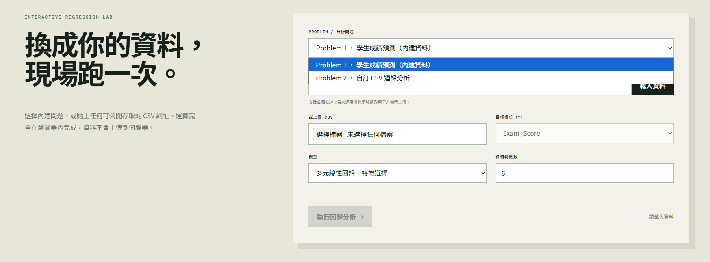
</p>

## 加分題 可自行填資料集

<p align="center">
  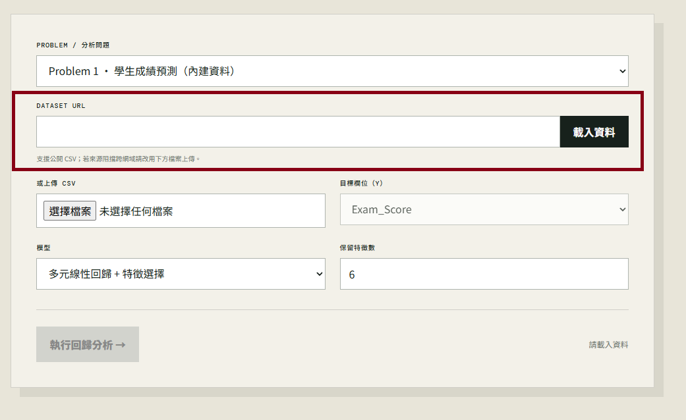
</p>

---

<div align="center">

# 學生成績預測：多元線性回歸與特徵選擇

### Student Performance Prediction with Multiple Linear Regression & RFE

[](https://www.python.org/)
[](https://scikit-learn.org/)
[](#crisp-dm-研究流程)
[](#模型評估結果)
[](#預測區間)

以 Kaggle **Student Performance Factors** 資料集為基礎，完整實作資料理解、前處理、線性回歸、RFE 特徵選擇、模型評估、殘差分析與 95% 預測區間。

[互動網站](./index.html) · [完整報告](./7115056039_hw2.pdf) · [Jupyter Notebook](./7115056039_hw2.ipynb) · [原始資料](./data/StudentPerformanceFactors.csv)

</div>

---

## 專案摘要

本研究以 `Exam_Score` 作為預測目標，比較三種線性回歸模型：

1. **Model A - Simple Linear Regression**：僅使用 `Hours_Studied`。
2. **Model B - Multiple Linear Regression**：使用全部 19 個原始輸入特徵。
3. **Model C - Multiple Linear Regression + RFE**：利用 RFE 與 5-Fold Cross-Validation 選擇特徵。

研究結果顯示，多元線性回歸的預測能力明顯優於只使用讀書時間的單純線性回歸。Model C 在減少特徵數量後，仍取得最佳測試表現：**MAE 0.4157、RMSE 1.5210、R² 0.8251**。此外，本研究使用 Split Conformal Prediction 建立 95% 預測區間，測試集實際涵蓋率為 **95.08%**。

> [!IMPORTANT]
> 本資料集屬於合成資料。研究結果反映資料中的統計關聯，不代表真實教育情境中的因果關係，亦不建議直接用於學生成績評定、升學決策或其他高風險教育用途。

## 目錄

- [作業目標](#作業目標)
- [資料集](#資料集)
- [CRISP-DM 研究流程](#crisp-dm-研究流程)
  - [Business Understanding](#1-business-understanding)
  - [Data Understanding](#2-data-understanding)
  - [Data Preparation](#3-data-preparation)
  - [Modeling](#4-modeling)
  - [Evaluation](#5-evaluation)
  - [Deployment](#6-deployment)
- [NotebookLM 研究摘要](#notebooklm-研究摘要)
- [互動網站功能](#互動網站功能)
- [專案結構](#專案結構)
- [執行方式](#執行方式)

---

## 作業目標

本作業延伸自 HW1，依照 **CRISP-DM** 流程，使用具有超過 13 個特徵的公開資料集完成多元線性回歸分析。研究重點包括：

- 以實際資料建立 Linear Regression 預測模型。
- 比較單純線性回歸、多元線性回歸與 RFE 模型。
- 執行 Feature Selection，降低模型複雜度。
- 以 MAE、RMSE 與 R² 評估模型。
- 透過殘差圖檢查系統性偏差與極端值。
- 使用 Split Conformal Prediction 建立 95% 預測區間。
- 將分析流程保存為可重現的 Pipeline 與模型檔案。

## 資料集

| 項目 | 說明 |
|---|---|
| 資料集 | Student Performance Factors |
| 來源 | [Kaggle - Student Performance Factors](https://www.kaggle.com/datasets/lainguyn123/student-performance-factors) |
| 原始資料量 | 6,607 筆、20 個欄位 |
| 輸入特徵 | 19 個 |
| 數值特徵 | 6 個 |
| 類別特徵 | 13 個 |
| 預測目標 | `Exam_Score` |
| 資料性質 | 合成資料 |

資料集涵蓋讀書時間、出席率、過去成績、家庭背景、學習資源、教師品質、同儕影響與身體活動等因素。

<details>
<summary><strong>查看全部欄位</strong></summary>

| 類型 | 欄位 |
|---|---|
| 數值 | `Hours_Studied`, `Attendance`, `Sleep_Hours`, `Previous_Scores`, `Tutoring_Sessions`, `Physical_Activity` |
| 類別 | `Parental_Involvement`, `Access_to_Resources`, `Extracurricular_Activities`, `Motivation_Level`, `Internet_Access`, `Family_Income`, `Teacher_Quality`, `School_Type`, `Peer_Influence`, `Learning_Disabilities`, `Parental_Education_Level`, `Distance_from_Home`, `Gender` |
| 目標 | `Exam_Score` |

</details>

---

## CRISP-DM 研究流程

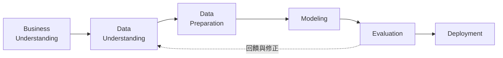

## 1. Business Understanding

本研究希望回答以下問題：

> 加入出席率、過去成績、家庭背景與學校環境等多項特徵後，能否比只使用讀書時間更準確地預測學生的考試成績？使用 RFE 減少特徵後，模型是否仍能維持相近的預測能力？

因此，以單純線性回歸作為 Baseline，再依序建立完整多元線性回歸與 RFE 多元線性回歸模型，評估預測效能與模型複雜度之間的取捨。

## 2. Data Understanding

### 2.1 考試成績分布

<p align="center">
  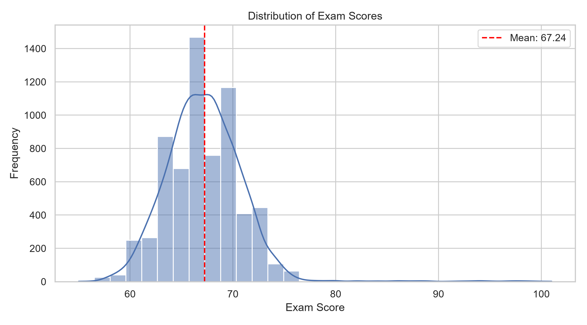
</p>

**主要觀察：**

- 平均考試成績為 **67.24 分**。
- 多數成績集中在約 **60-75 分**。
- 分布主體接近鐘形，但右側存在少數極端高分紀錄。
- 少部分資料高於 90 分，甚至出現超過 100 分的紀錄，後續需檢查其對 RMSE 與預測區間的影響。

### 2.2 特徵相關性

<p align="center">
  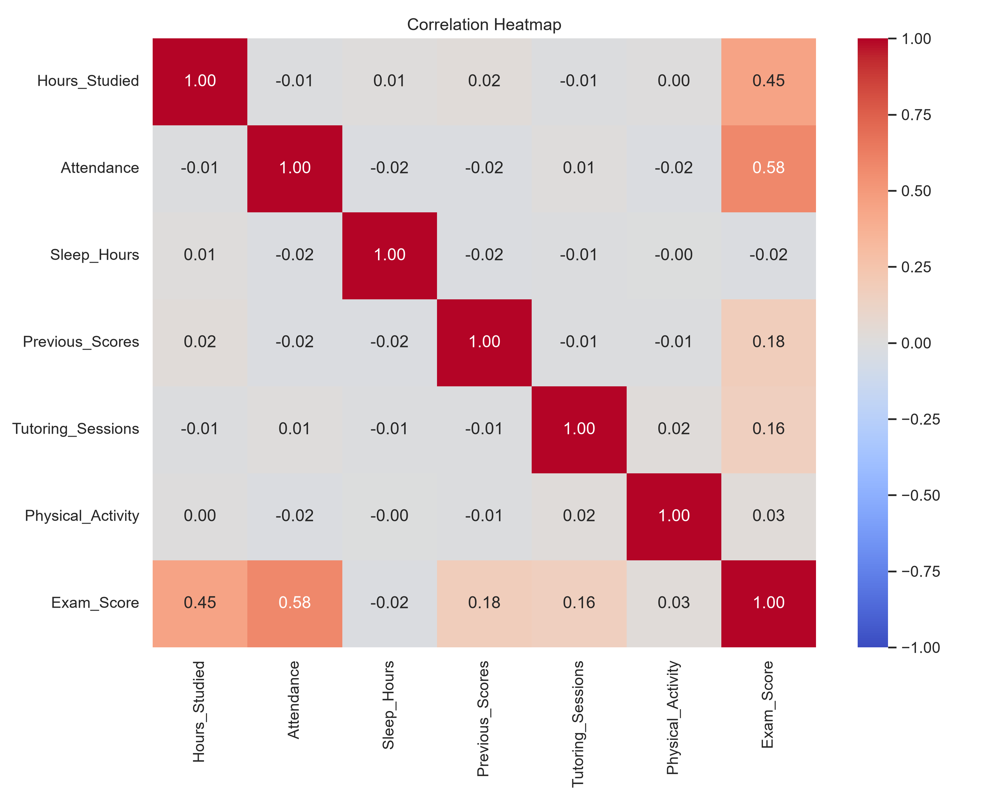
</p>

| 特徵 | 與 `Exam_Score` 的 Pearson 相關係數 | 解讀 |
|---|---:|---|
| `Attendance` | **0.58** | 數值特徵中最高，呈中度正相關 |
| `Hours_Studied` | **0.45** | 呈明顯正相關 |
| `Previous_Scores` | 0.18 | 弱正相關 |
| `Tutoring_Sessions` | 0.16 | 弱正相關 |

數值輸入特徵彼此的相關係數大多接近 0，沒有觀察到明顯的成對高度相關問題。不過，Pearson 相關係數只能描述線性關係，亦不能完全排除多重共線性；如需進一步檢查，可搭配 VIF。

### 2.3 讀書時間與考試成績

<p align="center">
  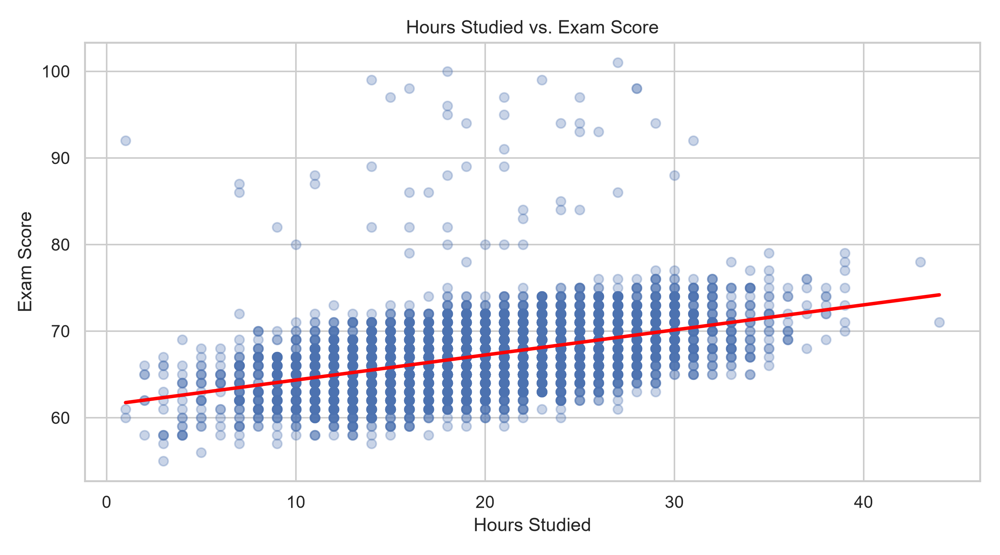
</p>

散佈圖顯示讀書時間與考試成績具有正向線性趨勢，與相關係數 `+0.45` 一致。然而，相同讀書時間附近仍存在明顯的成績差異，表示單一特徵不足以完整描述成績變化，亦說明建立多元線性回歸模型的必要性。

## 3. Data Preparation

### 3.1 資料清理與切分

- 原始資料共有 **6,607 筆、20 個欄位**。
- 發現一筆 `Exam_Score = 101`，超出研究定義的 0-100 分範圍，因此排除。
- 清理後保留 **6,606 筆有效資料**。
- 以 `random_state=42` 進行 80/20 Train-Test Split：
  - 訓練集：**5,284 筆**
  - 測試集：**1,322 筆**

### 3.2 缺失值

| 欄位 | 缺失筆數 | 處理方式 |
|---|---:|---|
| `Teacher_Quality` | 78 | 使用訓練資料眾數填補 |
| `Parental_Education_Level` | 90 | 使用訓練資料眾數填補 |
| `Distance_from_Home` | 67 | 使用訓練資料眾數填補 |

三個欄位的缺失比例約為 1.01%-1.36%，且皆為類別特徵，因此透過 `SimpleImputer(strategy="most_frequent")` 處理。

### 3.3 前處理 Pipeline

| 資料類型 | 前處理方式 |
|---|---|
| 數值特徵 | Median Imputation → StandardScaler |
| 類別特徵 | Most-frequent Imputation → OneHotEncoder |
| One-Hot 設定 | `drop="first"`, `handle_unknown="ignore"` |

所有前處理步驟皆整合於 `ColumnTransformer` 與 `Pipeline`，並且只以訓練資料擬合，以避免資料洩漏。13 個類別特徵經 One-Hot Encoding 後展開為 21 個欄位，再加上 6 個數值特徵，最終共有 **27 個編碼後特徵**。

```text
19 個原始特徵
├── 6 個數值特徵 ────────────────┐
└── 13 個類別特徵 → 21 個欄位 ──┼──> 27 個編碼後特徵
```

## 4. Modeling

### 4.1 Model A - Simple Linear Regression

Model A 僅使用 `Hours_Studied` 預測 `Exam_Score`，作為後續模型比較的 Baseline。模型透過 Pipeline 結合 `StandardScaler` 與 `LinearRegression`。

<p align="center">
  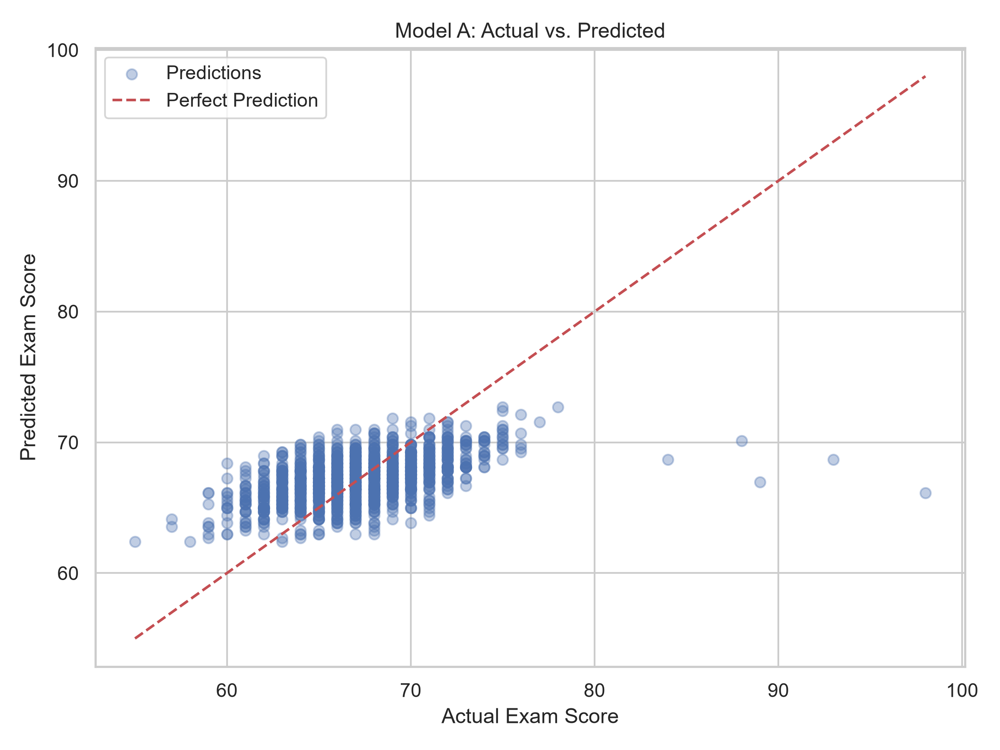
</p>

Model A 的預測值多集中於約 62-73 分，對高分學生容易低估、對部分低分學生則容易高估。R² 僅為 0.2469，顯示讀書時間雖有預測能力，但仍有許多成績變異無法由單一特徵解釋。

### 4.2 Model B - Multiple Linear Regression

Model B 使用全部 19 個原始輸入特徵，經缺失值填補、標準化與 One-Hot Encoding 後，共以 27 個編碼後特徵建立多元線性回歸模型。

<p align="center">
  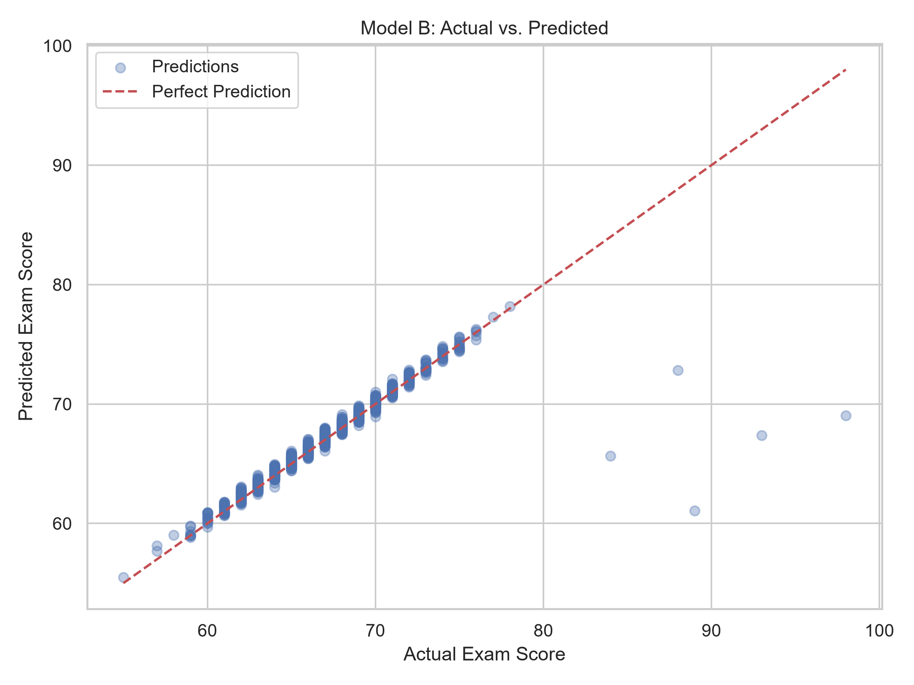
</p>

相較於 Model A，Model B 的 MAE 降低約 **82.8%**、RMSE 降低約 **51.8%**，R² 由 0.2469 提升至 0.8250。大部分預測點接近理想預測線，但模型對少數極端高分紀錄仍有明顯低估。

### 4.3 Model C - Multiple Linear Regression with RFE

Model C 使用 Recursive Feature Elimination（RFE）搭配 5-Fold Cross-Validation，僅在訓練資料內比較保留 5、10、15、20、25 與 27 個特徵時的 CV RMSE。

<p align="center">
  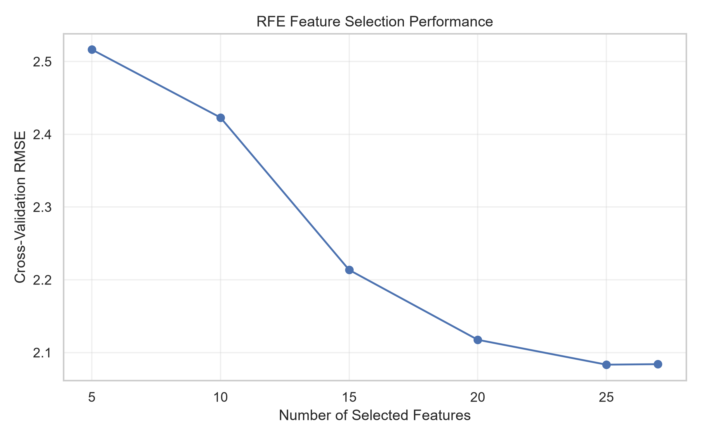
</p>

| 保留特徵數 | 5 | 10 | 15 | 20 | **25** | 27 |
|---:|---:|---:|---:|---:|---:|---:|
| CV RMSE | 2.5165 | 2.4230 | 2.2135 | 2.1175 | **2.0833** | 2.0840 |

交叉驗證結果選擇保留 **25 個特徵**。與使用全部 27 個特徵相比，特徵數量減少約 7.4%，CV RMSE 則幾乎相同。RFE 最終移除：

- `Sleep_Hours`
- `School_Type_Public`

<details>
<summary><strong>查看 RFE 選中的 25 個編碼後特徵</strong></summary>

1. `Hours_Studied`
2. `Attendance`
3. `Previous_Scores`
4. `Tutoring_Sessions`
5. `Physical_Activity`
6. `Parental_Involvement_Low`
7. `Parental_Involvement_Medium`
8. `Access_to_Resources_Low`
9. `Access_to_Resources_Medium`
10. `Extracurricular_Activities_Yes`
11. `Motivation_Level_Low`
12. `Motivation_Level_Medium`
13. `Internet_Access_Yes`
14. `Family_Income_Low`
15. `Family_Income_Medium`
16. `Teacher_Quality_Low`
17. `Teacher_Quality_Medium`
18. `Peer_Influence_Neutral`
19. `Peer_Influence_Positive`
20. `Learning_Disabilities_Yes`
21. `Parental_Education_Level_High School`
22. `Parental_Education_Level_Postgraduate`
23. `Distance_from_Home_Moderate`
24. `Distance_from_Home_Near`
25. `Gender_Male`

</details>

## 5. Evaluation

### 模型評估結果

| 模型 | 編碼後特徵數 | MAE ↓ | RMSE ↓ | R² ↑ |
|---|---:|---:|---:|---:|
| Model A - Simple LR | 1 | 2.4190 | 3.1559 | 0.2469 |
| Model B - Multiple LR | 27 | 0.4160 | 1.5213 | 0.8250 |
| **Model C - Multiple LR + RFE** | **25** | **0.4157** | **1.5210** | **0.8251** |

Model C 以較少的特徵取得三個模型中的最佳測試表現。雖然 Model B 與 Model C 的差異很小，但結果說明 RFE 能在降低模型複雜度的同時，保留幾乎相同的預測能力。

<p align="center">
  
</p>

### Model B 與 Model C 誤差比較

<p align="center">
  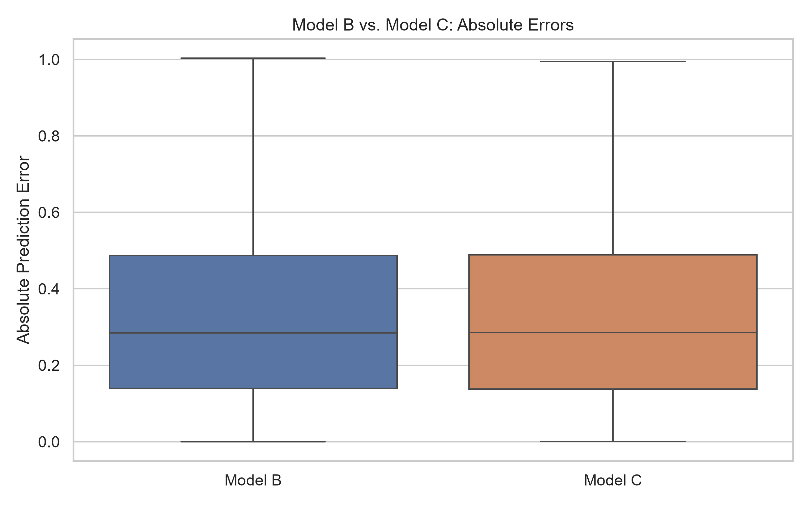
</p>

兩個模型的絕對誤差分布非常接近，進一步支持 RFE 模型可在減少特徵後維持完整模型的預測能力。

### 殘差分析

<p align="center">
  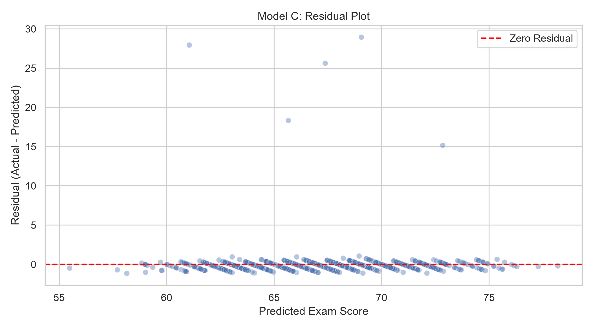
</p>

大部分殘差集中在 0 附近，通常落於 -1 至 +1 分之間，表示模型對主要成績區間具有良好預測能力。然而，有五筆高分資料的正殘差約介於 **15.17-28.95 分**，代表模型對少數極端高分學生存在明顯低估，亦對整體 RMSE 造成顯著影響。

### 預測區間

本研究使用 **Split Conformal Prediction** 建立 95% 預測區間：

1. 從原訓練集切出模型擬合集與校準集。
2. 在擬合集內重新執行交叉驗證與 RFE。
3. 使用 1,057 筆校準資料估計絕對預測誤差分位數。
4. 取得校準誤差分位數 `q ≈ 0.8044`，建立上下界。
5. 使用原測試集評估區間涵蓋率。

<p align="center">
  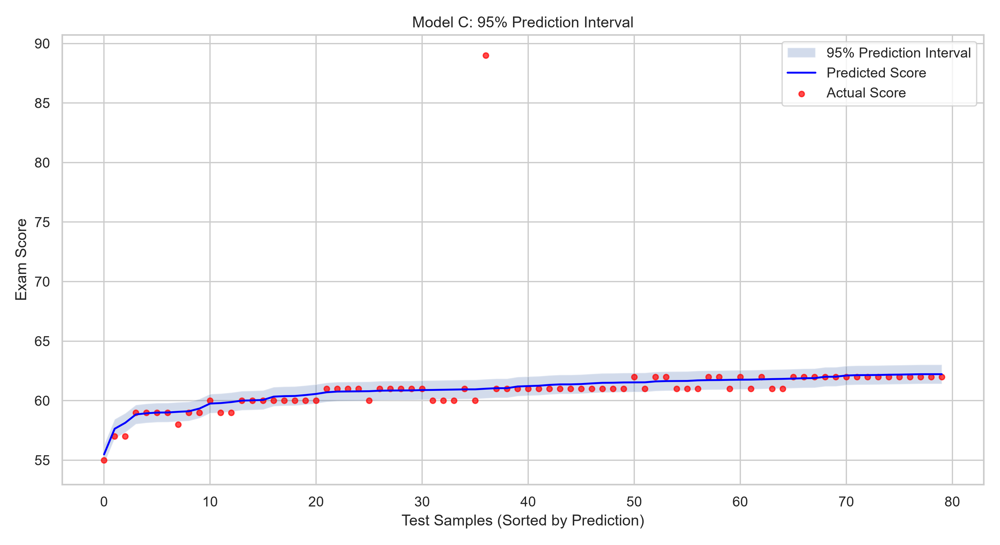
</p>

| 指標 | 結果 |
|---|---:|
| 目標涵蓋率 | 95% |
| 實際涵蓋率 | **95.08%** |
| 平均區間寬度 | **1.6089 分** |
| 區間半寬 | 約 **0.8044 分** |

預測區間達到接近 95% 的邊際涵蓋率，且對大部分學生提供相對窄的預測範圍。不過，部分極端高分紀錄仍超出預測區間，因此整體涵蓋率不代表每個成績區間都具有相同的預測可靠性。

## 6. Deployment

完成訓練後，使用 `joblib` 保存兩組模型：

| 檔案 | 內容 |
|---|---|
| [`models/model_C.joblib`](./models/model_C.joblib) | 前處理、RFE 特徵選擇與線性回歸 Pipeline |
| [`models/prediction_interval.joblib`](./models/prediction_interval.joblib) | 區間模型與校準誤差分位數 `q` |

重新載入模型後，以一筆測試資料驗證部署流程：

```text
Model C 預測成績：66.01
區間模型預測成績：66.06
95% 預測區間：[65.25, 66.86]
實際成績：66
```

保存的 Pipeline 包含一致的資料前處理、特徵選擇及預測流程，使模型重新載入後仍可重現分析結果。

---

## NotebookLM 研究摘要

根據 NotebookLM 整理的相關文獻，學生成績預測常使用 Random Forest、XGBoost 及 LightGBM 等集成學習方法。這些模型能捕捉非線性關係與特徵之間的交互作用，適合處理較複雜的預測問題，但通常需要額外的模型解釋技術。本研究採用 Multiple Linear Regression，並透過 RFE 進行特徵選擇。完整多元線性回歸的測試集 R² 為 0.8250，RFE 模型為 0.8251，表示模型能在減少部分特徵的情況下維持相近效能。不過，由於各研究的資料切分、前處理及實驗設定不同，不能據此認定線性模型普遍優於 LightGBM 或其他非線性模型。若未來應用於真實教育資料，仍應在相同資料與評估條件下，比較線性及非線性模型的泛化能力。

## 研究結論與限制

### 結論

- 只使用讀書時間的 Model A 解釋力有限，R² 為 0.2469。
- 加入出席率、過去成績、學習資源等特徵後，Model B 的 R² 提升至 0.8250。
- RFE 選擇 25 個特徵後，Model C 以 R² 0.8251 取得最佳表現。
- 95% Split Conformal Prediction Interval 的實際涵蓋率為 95.08%。
- 多元線性回歸能提供良好且相對透明的預測流程，但對極端高分資料仍有明顯低估。

### 限制

- 資料集為合成資料，結果不應直接推廣至真實教育環境。
- 線性模型難以捕捉複雜的非線性關係及特徵交互作用。
- 特徵選擇反映目前資料與模型設定下的預測貢獻，不代表因果影響。
- 整體 95% 涵蓋率不保證每個成績區間都具有相同可靠性。

---

## 互動網站功能

本專案亦提供可部署至 GitHub Pages 的互動式分析網站：

- 下拉選單切換兩種分析問題。
- 使用內建學生成績資料，或輸入任意公開 CSV URL。
- 支援直接上傳本機 CSV 檔案。
- 自動辨識數值欄位與選擇預測目標。
- 執行單純或多元線性回歸。
- 依 Pearson 相關係數進行瀏覽器端特徵選擇。
- 顯示 MAE、RMSE、R² 與 Actual vs. Predicted 散佈圖。

> [!NOTE]
> 遠端 CSV 必須允許瀏覽器跨網域存取（CORS）。若來源阻擋，請先下載 CSV，再使用網站內的檔案上傳功能。

## 專案結構

```text
AIOT_HW2_Multiple-Linear-regression/
├── index.html                          # 互動網站
├── styles.css                         # 網站樣式
├── app.js                             # CSV、回歸與圖表邏輯
├── README.md                          # 專案說明
├── 7115056039_hw2.ipynb               # 完整分析 Notebook
├── 7115056039_hw2.pdf                 # 完整作業報告
├── data/
│   └── StudentPerformanceFactors.csv  # 原始資料集
├── figures/
│   ├── 01_score_distribution.png
│   ├── 02_correlation_heatmap.png
│   ├── 03_study_hours_vs_score.png
│   ├── 04_model_A_predictions.png
│   ├── 05_model_B_predictions.png
│   ├── 06_rfe_cv_results.png
│   ├── 07_model_C_predictions.png
│   ├── 08_model_B_C_errors.png
│   ├── 09_model_C_residuals.png
│   └── 10_prediction_interval.png
└── models/
    ├── model_C.joblib
    └── prediction_interval.joblib
```

## 執行方式

### 執行 Notebook

```powershell
jupyter notebook 7115056039_hw2.ipynb
```

### 預覽互動網站

因瀏覽器不允許從 `file://` 直接讀取相對路徑資料，請在專案根目錄啟動靜態伺服器：

```powershell
npx serve .
```

再開啟終端機顯示的 Local URL。

### 部署 GitHub Pages

1. 前往 repository 的 **Settings → Pages**。
2. Source 選擇 **Deploy from a branch**。
3. Branch 選擇 `main`，資料夾選擇 `/ (root)`。
4. 按下 **Save**，等待 GitHub Pages 完成部署。

---

<div align="center">

**7115056039 · Internet of Things · HW2**

Multiple Linear Regression · RFE Feature Selection · Split Conformal Prediction

</div>
